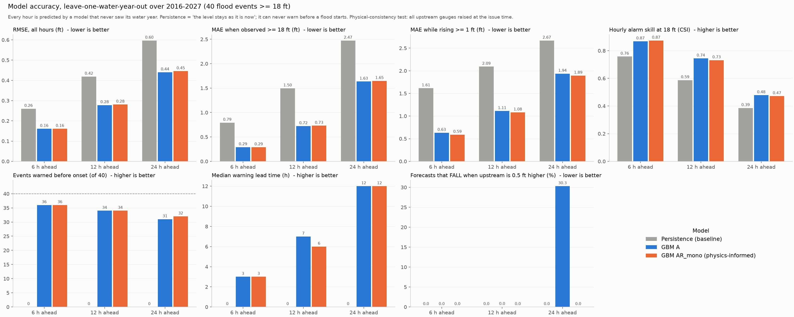
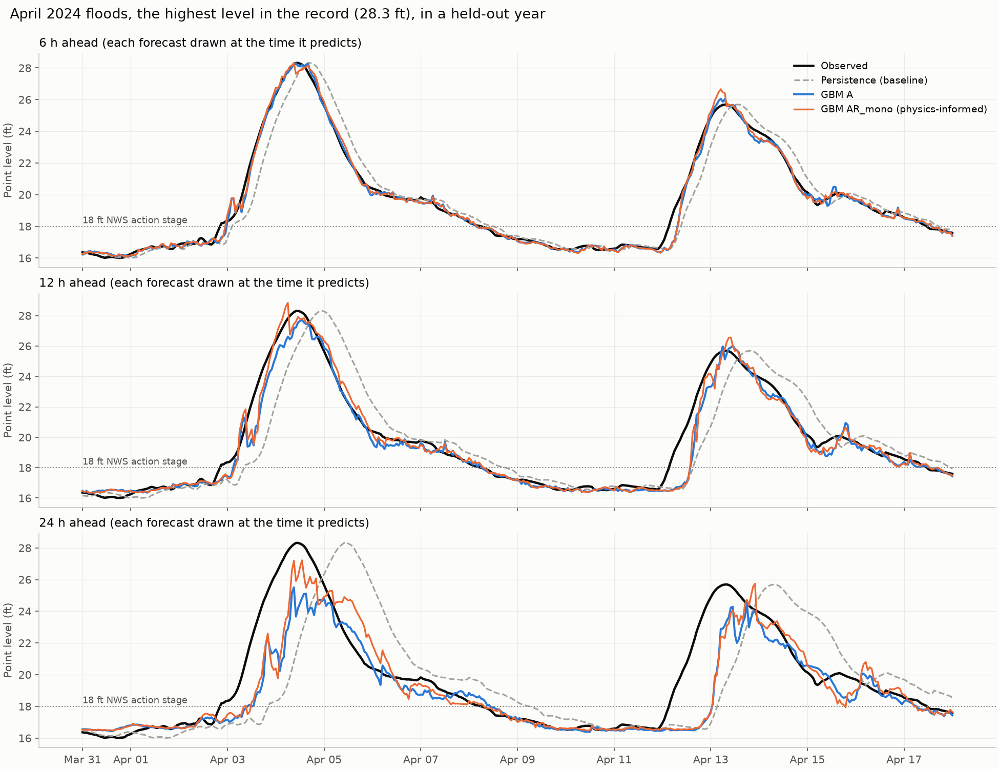

# Forecasting the water level at the Point: model results

This folder holds the results for two models, **GBM A** and its physics-informed version **GBM AR_mono**,
compared with the **persistence baseline**. It also describes how they differ from the models in the teammate
notebook `src/systems_final_project/model.ipynb`, which is commit `72eca72` on GitHub.

**Bottom line**

- Both models clearly beat persistence at 6, 12 and 24 hours ahead.
- They warn of **31 to 36 of the 40 floods before they start**. Persistence can warn of none, by construction.
- **Their accuracy is almost the same. AR_mono is physically consistent; A is not.** When every upstream gauge
  is raised by 0.5 ft, A's 24 h forecast *falls* in 30.3% of hours. AR_mono's never falls, at any horizon.
- AR_mono is also more accurate while the river is rising.

---

## 1. What is being predicted

- **Target:** the water level at **USGS 03085152, the Monongahela at Point State Park**, 6, 12 and 24 hours
  ahead, issued every hour.
- **Alarm level:** **18 ft**, the NWS *action stage* for Pittsburgh. Water starts reaching the Mon Wharf at
  18 ft and the North Shore riverwalk at 19 ft. Flood stage is 25 ft.
- **Flood events:** a flood event is a run of hours at or above 18 ft. Runs less than 24 h apart count as one
  event. There are **40 events** in water years 2016–2027.

## 2. The models

All three predict the **change** in level over the next *h* hours. The forecast is the current level plus that
change. Each horizon has its own model.

| Model | What it is | Inputs |
|---|---|---|
| **Persistence (baseline)** | "The level in *h* hours = the level now." No training. | Point's current level |
| **GBM A** | Gradient boosting (scikit-learn `HistGradientBoostingRegressor`) | 52 features, all still reported in real time |
| **GBM AR_mono** — *physics-informed A* | The same model and settings as A, plus a fitted **routing** model's forecast as an input (**R**) and **monotonic** constraints (**mono**) | A's 52 features plus the routing forecast |

### The 52 features of GBM A (shared by both models)

Features are built in `src/systems_final_project/features.py`. The models are in `models.py`, and the routing
model is in `physics.py`.

| Group | Features | Count |
|---|---|---|
| Point's own history | level now, 6 h ago, 24 h ago; rise over the last 1 h and 6 h; highest level in the last 24 h | 6 |
| Upstream gauges | **Natrona, Kittanning** (Allegheny) and **Sutersville** (Youghiogheny): level now, 6 h ago, 12 h ago, and rise over 1 h and 6 h. **Braddock** (Monongahela): rise over 1, 6 and 12 h only, because Dam 3's removal in July 2024 shifted its level | 18 |
| Observed rain (ERA5 via Open-Meteo) | totals over the past 6, 24, 48 and 72 h at Pittsburgh, Kittanning, Elizabeth, Sutersville and their average | 20 |
| Season | day of year as sin and cos | 2 |
| Flags | after Dam 3 removal (`post_dam3`); hour filled from a short gap, one flag per gauge | 6 |

### What AR_mono adds

This approach is adapted from the routing model in a sibling version of this project.

**1. A fitted routing model (`physics.py`).** It describes how a rise at each upstream gauge travels down to the
Point.

- **Response curve:** each upstream gauge (Natrona, Kittanning, Sutersville, Braddock) gets a curve saying how
  much the Point rises 1, 2, …, 36 hours after that gauge rises 1 ft. The Point's predicted change is the sum of
  the upstream changes weighted by these curves.
- **Unknown future:** upstream readings after the forecast time are not known yet, so they are held at their
  current value.
- **Physical constraints on the curves:**
  - **non-negative:** a rise upstream can never lower the Point;
  - **smooth:** a flood wave spreads out as it travels;
  - **shared by all three horizons:** the same river physics applies whatever the forecast length.
- **Recession:** with no new water arriving, the Point drains back toward the Emsworth Dam pool, like a linear
  reservoir.
- **Fitting:** it is solved as a bound-constrained least-squares problem and **refitted in every fold, on that
  fold's training years only**.
- **What it learns, fitted on all years** (printed by `evaluation.py`):

  | Gauge | Mean travel time to the Point | Total gain (ft at the Point per ft upstream) |
  |---|---|---|
  | Natrona (Allegheny) | 2.6 h | 0.50 |
  | Kittanning (Allegheny) | 2.7 h | 0.48 |
  | Braddock (Monongahela) | 3.4 h | 0.59 |
  | Sutersville (Youghiogheny) | 3.6 h | 0.53 |

  The pool level the Point drains toward is **16.74 ft**. It was fitted from the data, not set by hand.

**2. Its forecast becomes one extra input** to the gradient boosting.

**3. Monotonic constraints.** The forecast may only go **up** when any of these goes up:

- the current upstream levels;
- the upstream rises;
- the rain totals;
- the routing forecast.

Those are 33 of the 53 inputs. The Point's own history, season and flags are left free, because a high Point
often means the water is about to fall.

**Settings shared by A and AR_mono:**

- `learning_rate=0.05`, `max_iter=400`, `max_leaf_nodes=31`, `min_samples_leaf=40`, `l2_regularization=1.0`,
  `random_state=0`.
- `early_stopping=False`. With early stopping on, scikit-learn would hold out a random 10% of hours for
  validation, and neighbouring hours would end up on both sides of that split.
- Missing inputs are left as NaN; the trees handle them directly.

## 3. How the models are evaluated

- **Leave-one-water-year-out:** this is the 12-fold version of the proposal's leave-one-year-out plan.
  - Water years run October to September.
  - Each year from 2016 to 2027 is predicted by a model trained on all the other years.
  - Training rows whose *target* falls in the test year are dropped.
  - Every scored hour therefore comes from a model that never saw its year.
- **Scored hours:** all hours where the current and future levels are known, about **97,200 per horizon**. Every
  model is scored on exactly the same hours.
- **Metrics:**

  | Metric | What it measures |
  |---|---|
  | RMSE | error over all hours |
  | High-water MAE | error when observed ≥ 18 ft |
  | Rising MAE | error when the river rises ≥ 1 ft within the horizon |
  | Precision, recall, CSI | hourly alarm skill at 18 ft. CSI = hits / (hits + misses + false alarms) |
  | Events warned early | out of 40: an alarm issued **before** the event starts, for a time inside the event |
  | Lead time | how many hours before the event start that first alarm was issued |
  | **Physical consistency** | every upstream gauge is raised by 0.5 ft at the forecast time (level and recent rises). This is the share of held-out hours where the forecast **falls** by more than 0.01 ft. A physically sensible model should never do that |

## 4. Results (leave-one-water-year-out, 2016–2027, 40 events)



| Horizon | Model | RMSE (ft) | High-water MAE (ft) | Rising MAE (ft) | Precision | Recall | CSI | Events warned early | Median lead | Forecast falls when upstream rises |
|---|---|---|---|---|---|---|---|---|---|---|
| 6 h | Persistence | 0.260 | 0.792 | 1.614 | 0.862 | 0.862 | 0.758 | 0 / 40 | 0 h | 0% |
| 6 h | GBM A | 0.161 | 0.290 | 0.631 | 0.959 | 0.902 | 0.868 | 36 / 40 | 3 h | 0.01% |
| 6 h | **GBM AR_mono** | 0.161 | 0.289 | **0.588** | 0.951 | 0.915 | 0.873 | 36 / 40 | 3 h | **0%** |
| 12 h | Persistence | 0.419 | 1.495 | 2.092 | 0.740 | 0.740 | 0.587 | 0 / 40 | 0 h | 0% |
| 12 h | GBM A | 0.278 | 0.722 | 1.112 | 0.891 | 0.819 | 0.744 | 34 / 40 | 7 h | 0.03% |
| 12 h | **GBM AR_mono** | 0.281 | 0.730 | **1.082** | 0.888 | 0.806 | 0.731 | 34 / 40 | 6 h | **0%** |
| 24 h | Persistence | 0.597 | 2.473 | 2.667 | 0.555 | 0.558 | 0.386 | 0 / 40 | 0 h | 0% |
| 24 h | GBM A | 0.440 | 1.634 | 1.936 | 0.676 | 0.621 | 0.479 | 31 / 40 | 12 h | **30.3%** |
| 24 h | **GBM AR_mono** | 0.445 | 1.648 | **1.894** | 0.668 | 0.615 | 0.471 | 32 / 40 | 12 h | **0%** |

Persistence ignores the upstream gauges, so it can never fall when they rise.

**Reading the table**

- **Both models vs persistence:**
  - RMSE is 38%, 34% and 26% lower for A, and 38%, 33% and 25% lower for AR_mono, at 6, 12 and 24 h.
  - High-water error is 63%, 52% and 34% lower for A, and about the same for AR_mono.
- **24 h is the weakest horizon**, as the proposal expected. In April 2024 the 24 h forecasts under-predict
  both peaks and are late (see the figure below).

### GBM A vs GBM AR_mono

- **Overall accuracy is effectively the same.**
  - RMSE differs by at most 0.005 ft.
  - High-water MAE differs by at most 0.014 ft.
  - Events warned early: 36/36 at 6 h, 34/34 at 12 h, 31 vs 32 at 24 h.
  - CSI: 0.868 vs 0.873 at 6 h, 0.744 vs 0.731 at 12 h, 0.479 vs 0.471 at 24 h.
- **While the river is rising, AR_mono is more accurate at every horizon.** Rising MAE is 0.043, 0.030 and
  0.042 ft lower.
- **Physical consistency is where they really differ.**
  - A's 24 h model lowers its forecast in **30.3% of held-out hours** when more water is upstream. It has
    learned patterns that fit the data but contradict the physics, for example "a high upstream level means
    the peak has already passed".
  - AR_mono never does this, at any horizon.
- **Recommendation:** use **GBM AR_mono**. It is as accurate as A, better on rising water, never contradicts
  the river physics, and its routing model gives interpretable travel times.

### April 2024: the highest level in the record (28.3 ft), in a held-out year



- **6 h:** both models track the rise and the peak closely. AR_mono overshoots the second peak slightly.
  Persistence is the observed curve shifted 6 h late.
- **12 h:** AR_mono reaches the first peak earlier than A, slightly overshooting it. Both are far closer than
  persistence.
- **24 h:** both models rise before persistence but under-predict both peaks. AR_mono's first peak, about 27 ft,
  comes closer to the observed 28.3 ft than A's, about 25.5 ft.

## 5. Comparison with the teammate model (`model.ipynb`)

### How the two approaches differ

| | `model.ipynb` | Ours (GBM A / AR_mono) |
|---|---|---|
| Models | persistence, persistence + 6 h trend, `LinearRegression`, `HistGradientBoostingRegressor` | persistence, GBM A, GBM AR_mono |
| GBM settings | `max_iter=300`, `learning_rate=0.05`, `max_leaf_nodes=31`, otherwise defaults. Early stopping is on by default, so a random 10% of hours is held out | `max_iter=400`, `min_samples_leaf=40`, `l2_regularization=1.0`, early stopping off |
| Target | 6 h change in level (only 6 h was run) | change in level at 6, 12 and 24 h |
| Features | **25** | **52** for A; **52 + routing forecast** for AR_mono |
| Upstream gauges | changes only (1/3/6 h) at Braddock, Sutersville, Natrona, Kittanning | changes, **plus absolute levels (now, 6 h, 12 h ago)** at Natrona, Kittanning, Sutersville. Braddock uses changes only |
| Point history | level, 1/3/6 h changes | level, 6 h and 24 h ago, 1/6 h changes, **24 h max** |
| Rain | 6/24/48 h totals: Allegheny (= Kittanning), Mon (average of Elizabeth and Sutersville), Pittsburgh | 6/24/48/**72 h** totals at 4 sites separately plus their average |
| Season and flags | none | day of year, Dam 3 flag, gap-fill flags |
| Physics | none | AR_mono: fitted routing model + monotonic constraints |
| Elizabeth gauge | left out | left out (only its rainfall is used) |
| Validation | walk-forward: each year from 2019 to 2026 is trained only on earlier years | leave-one-water-year-out over all of 2016–2027 |
| Alarm level | **20 ft** | **18 ft** (NWS action stage) |
| Alarm scoring | event "caught" if the alarm is on in the 24 h before onset; counts false-alarm *periods* | event warned if an alarm issued before onset targets a time inside the event; hourly precision, recall and CSI |

The two share **17 identical features**:

- Point's level and 1 h and 6 h changes;
- the 1 h and 6 h changes at the four upstream gauges;
- the 6/24/48 h rain totals at Kittanning and Pittsburgh.

The notebook has 8 features we don't: 3 h changes and the averaged Mon rain. We have 35 it doesn't.

The notebook itself is on GitHub but not in the current local checkout, which is at `b2bce37`.

### To agree on as a team

1. **Alarm level:** 18 ft (NWS action stage) or 20 ft.
2. **Event scoring rule:** one rule for the report.
3. **Main validation scheme:** leave-one-year-out, as in the proposal, or walk-forward. Leave-one-year-out also
   trains on years after the test year, so it may be somewhat optimistic.

## 6. Caveats

- **Rain data:** observed rain is ERA5, which is published about 5 days late. These results assume rain is known
  up to the forecast time. A real-time system needs a live rain source.
- **Few events:** only 40 floods in 11 years, so differences of one or two events are noise.
- **Routing input on training rows:** in each fold, the routing model is fitted on the same training years the
  gradient boosting learns from. Its forecast on those rows is therefore slightly better than it will be on new
  data.
- **Braddock in the routing model:** the routing model uses Braddock's raw level, which shifted when Dam 3 was
  removed. A step change only affects the few hours when it falls inside the 36 h window.

## 7. Reproduce

From the repository root, after `uv sync`:

```bash
uv run python -m systems_final_project.features      # 1. data/features/
uv run python -m systems_final_project.models --force  # 2. results/predictions/ (~8 min)
uv run python -m systems_final_project.evaluation    # 3. results/figures/ + metrics and routing travel times
```

Without `--force`, step 2 keeps any model that already has a predictions file.

### Code layout (`src/systems_final_project/`)

```
data/config.py    every path, gauge ID and date range (shared with the teammate download code)
data/             downloads and cleaning (teammate code; produces data/clean/hourly.parquet)
features.py       model inputs and targets                 -> data/features/
physics.py        fitted routing model (response kernels + recession), used by gbm_AR_mono
models.py         gbm_A, gbm_AR_mono, persistence           -> results/predictions/
evaluation.py     scoring, consistency test, the two figures -> results/figures/
```

### Outputs (`results/`)

| Path | Contents |
|---|---|
| `predictions/{gbm_A,gbm_AR_mono}.parquet` | hourly held-out forecasts (`pred_6h`, `pred_12h`, `pred_24h`) and the forecasts with upstream raised 0.5 ft (`pert_*`) |
| `predictions/persistence.parquet` | persistence forecasts (`pred_*`) |
| `figures/fig1_accuracy.png` | accuracy and physical consistency over all 40 flood events (section 4) |
| `figures/fig2_april_2024.png` | forecasts during the April 2024 floods (section 4) |
